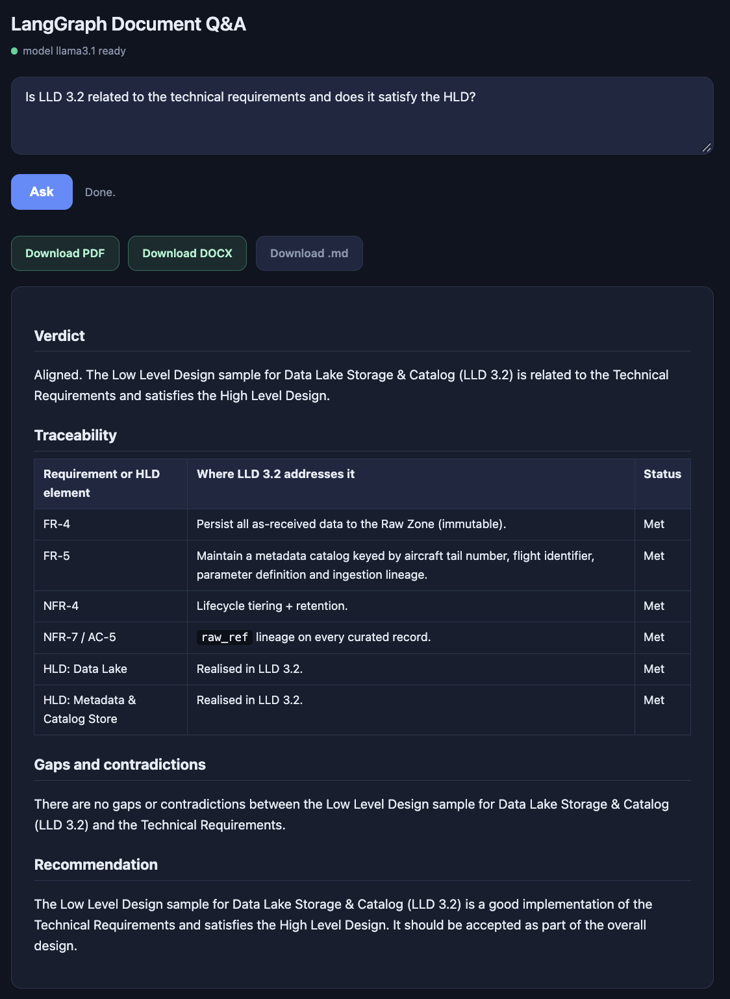
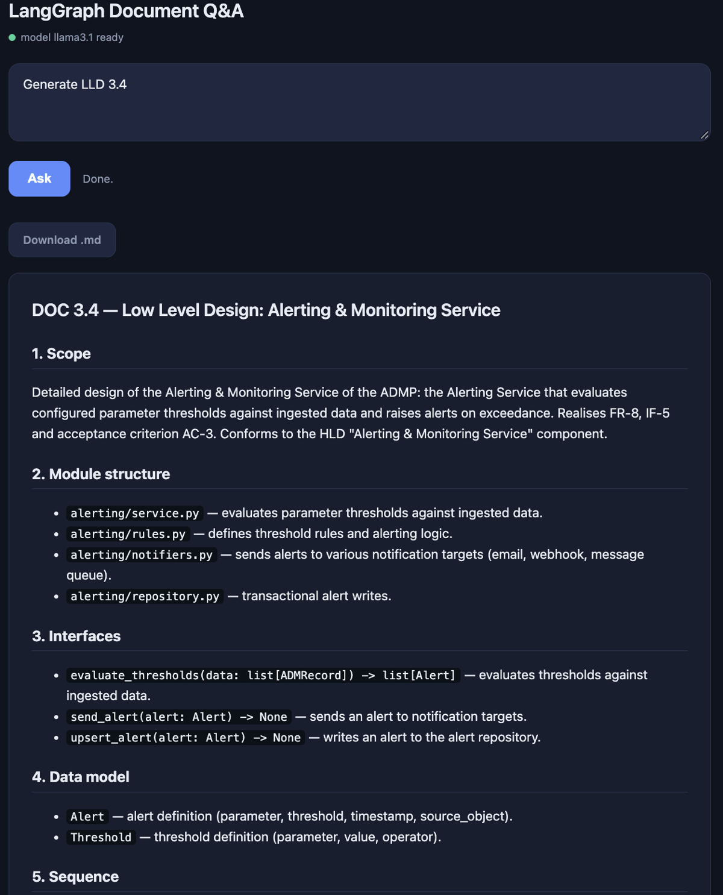
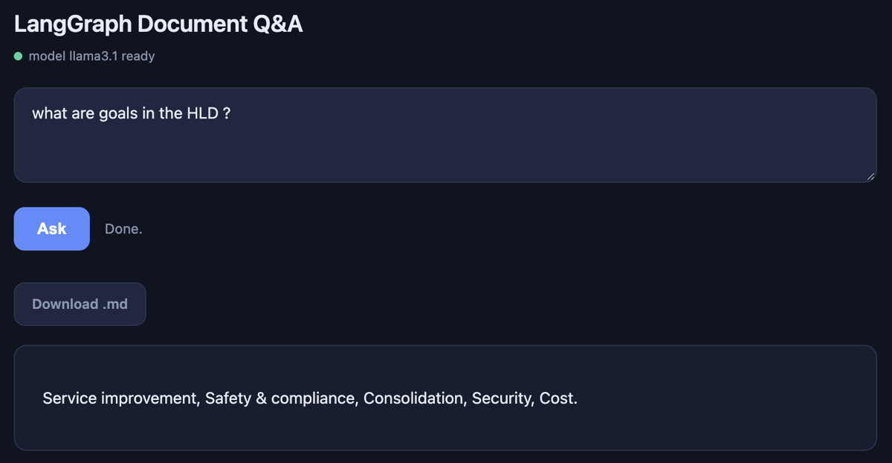
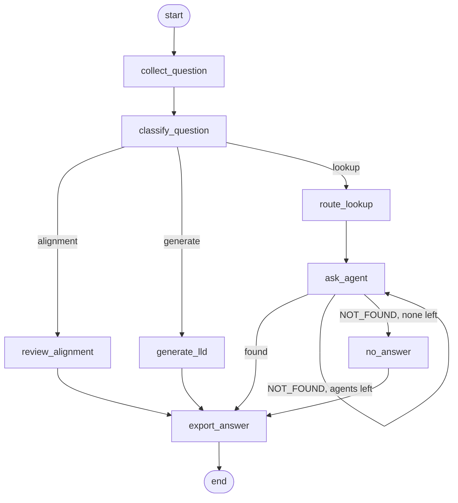

# LangGraph Document Q&A

**A multi-agent RAG system built on LangGraph that answers questions across a document set (High Level Design, Technical Requirements, Low Level Designs), reviews a design for alignment, and drafts new designs. It runs entirely on local models.**


-black)


No cloud API, no API key and no data leaving your machine: the language model and the embeddings are served by [Ollama](https://ollama.com).

## Key concepts

| Concept | How it is used here |
|---|---|
| **LangGraph `StateGraph`** | The whole workflow is an explicit graph with typed state, nodes and conditional edges, not a hand-written loop. |
| **Multi-agent RAG** | One agent per document collection (HLD, Technical Requirements, LLD). Each answers only from its own FAISS index. |
| **Question routing** | A router node asks the model which document most likely holds the answer and orders the agents accordingly. |
| **Backtracking** | An agent that cannot answer replies `NOT_FOUND`; a conditional edge loops back and asks the next agent, until one answers or none are left. |
| **Whole-document context vs. retrieval** | Lookups use chunk retrieval. Design review and generation need the full documents, so those branches read them whole instead of retrieving fragments. |
| **Grounded answers** | Agents are told to use only the retrieved excerpts, and every excerpt carries its source file. |
| **Local-first** | Ollama (`llama3.1`, `nomic-embed-text`), FAISS on disk, Docker Compose for the whole stack. |
| **Testable without a model** | The model clients are injected, so the full graph, the real agents and real FAISS indexes are tested with a scripted fake model. |

## What it does

Ask a question in plain English. The graph classifies it and takes one of three paths:

| Path | Example question | Result |
|---|---|---|
| **Alignment review** | *Is LLD 3.2 related to the technical requirements and does it satisfy the HLD?* | Verdict, a traceability table (requirement to LLD section) and a list of gaps or contradictions. |
| **Design generation** | *Generate LLD 3.4 from 3.1/3.2/3.3 satisfying the technical requirements and HLD* | A complete new LLD in the same structure as the existing samples. |
| **Lookup** | *What are the goals in the HLD?* | A cited answer from whichever document holds it, found by routing and backtracking. |

Every answer is saved as Markdown and exported to DOCX and PDF when the tools are available.

## Screenshots

**Alignment review** of LLD 3.2 against the Technical Requirements and the HLD, with a traceability table and PDF / DOCX / Markdown downloads:



**Design generation**: a complete new LLD 3.4 drafted from the three sample LLDs:



**Lookup**: a factual question routed to the right document:



## The workflow



The graph is defined in [`src/graph.py`](src/graph.py). `classify_question` and `after_agent` are the two conditional edges; the loop on `ask_agent` is the backtracking.

## Deliverables

- **LangGraph workflow** with typed state, eight nodes and conditional routing ([`src/graph.py`](src/graph.py)).
- **Three document agents** with per-collection FAISS indexes and a `NOT_FOUND` contract ([`src/agents.py`](src/agents.py), [`src/retrievers.py`](src/retrievers.py), [`src/ingest.py`](src/ingest.py)).
- **Review and generation chains** that work on whole documents ([`src/evaluation.py`](src/evaluation.py)).
- **Web UI and REST API** built with FastAPI ([`src/api.py`](src/api.py), [`frontend/index.html`](frontend/index.html)).
- **Command line** interface ([`src/main.py`](src/main.py)).
- **Export** to Markdown, DOCX (pandoc) and PDF (WeasyPrint) ([`src/export.py`](src/export.py)).
- **Docker Compose stack**: Ollama, a one-shot model puller and the app.
- **Test suite** (42 tests, no model needed) and **GitHub Actions** CI running lint, tests and a Docker build.
- **Sample documents** and **example outputs** in [`data/`](data) and [`docs/examples/`](docs/examples).

## Quick start (Docker)

Requires Docker with Compose. The first run downloads the models (a few GB).

```bash
git clone https://github.com/Mounish16/langgraph-document-qa.git
cd langgraph-document-qa
cp .env.example .env
docker compose up -d --build
docker compose logs -f model-puller
```

Press Ctrl+C once the log shows both models have been pulled, then open **http://localhost:8000**. The indexes are built automatically on your first question. To confirm the models are present: `docker exec ollama ollama list`.

> **Memory and speed.** Review and generation put whole documents into a 16k-token context, which needs several GB of free memory on top of the model itself for `llama3.1`. Docker Desktop on macOS cannot use the Apple GPU and limits memory, so answers are slow and the model can be stopped for lack of memory. On a Mac, [run without Docker](#run-without-docker) with the native Ollama app instead. On a smaller machine, set `LLM_MODEL=llama3.2:3b` in `.env`.

Stop with `docker compose down` (add `-v` to also delete the downloaded models).

## Run without Docker

Requires Python 3.11 or newer and [Ollama](https://ollama.com) running locally. This is the fastest option on a Mac, because Ollama can use the GPU.

```bash
ollama pull llama3.1
ollama pull nomic-embed-text

python3 -m venv .venv
source .venv/bin/activate
pip install -r requirements.txt
cp .env.example .env

python -m src.ingest
python -m uvicorn src.api:app --port 8000
```

On Windows, activate with `.venv\Scripts\Activate.ps1`. DOCX and PDF export are optional: install [pandoc](https://pandoc.org/installing.html) for DOCX and the WeasyPrint system libraries for PDF. Without them the answer is still saved as Markdown.

### Command line

```bash
python -m src.main "Is LLD 3.2 related to the technical requirements and does it satisfy the HLD?"
python -m src.main "Generate LLD 3.4 from 3.1/3.2/3.3 satisfying the technical requirements and HLD"
python -m src.main "What are the goals in the HLD?"
```

### REST API

| Endpoint | Purpose |
|---|---|
| `GET /api/status` | Ollama reachability, the document collections and whether each index is built |
| `POST /api/ingest` | (Re)build the indexes |
| `POST /api/ask` | `{"question": "..."}` returns the answer, the mode and download file names |
| `GET /api/download/{name}` | Download an exported answer |

```bash
curl -s localhost:8000/api/ask -H 'content-type: application/json' \
  -d '{"question": "What are the goals in the HLD?"}'
```

## Example outputs

Sample outputs for the bundled documents are in [`docs/examples/`](docs/examples):

- [Alignment review of LLD 3.2](docs/examples/alignment_review_lld_3_2.md) ([PDF](docs/examples/alignment_review_lld_3_2.pdf))
- [Generated LLD 3.4](docs/examples/generated_lld_3_4.md) ([PDF](docs/examples/generated_lld_3_4.pdf))

Output quality depends on the local model, so your results will vary. The screenshots above were taken with `llama3.1`.

## Project layout

```
src/
  graph.py        LangGraph StateGraph: nodes, conditional edges, backtracking loop
  evaluation.py   question classifier, review and generation chains, routing, saving
  agents.py       per-collection RAG agents (NOT_FOUND contract)
  retrievers.py   FAISS loading and retrieval
  ingest.py       load, chunk, embed and index the documents (also a CLI)
  llm.py          the only place model clients are created
  export.py       Markdown to DOCX / PDF
  api.py          FastAPI app
  main.py         command line entry point
  config.py       settings from environment variables
data/             sample HLD, Technical Requirements and three LLDs
frontend/         single-page web UI
tests/            unit, graph and API tests (fake model)
docs/examples/    sample outputs
```

## Configuration

Set in `.env` (see [`.env.example`](.env.example)):

| Variable | Default | Meaning |
|---|---|---|
| `OLLAMA_BASE_URL` | `http://localhost:11434` | Ollama server |
| `LLM_MODEL` / `EMBED_MODEL` | `llama3.1` / `nomic-embed-text` | Chat and embedding models |
| `LLM_NUM_CTX` | `16384` | Context window; review and generation feed whole documents, so keep it large |
| `CHUNK_SIZE` / `CHUNK_OVERLAP` / `TOP_K` | `1000` / `150` / `5` | Chunking and retrieval |
| `DATA_DIR` / `INDEX_DIR` / `OUTPUT_DIR` | `data` / `faiss_index` / `outputs` | Paths |

The `.env` file is read automatically; restart the server after changing it. To use your own documents, replace the files under `data/` (keep the three sub-folders), then rebuild with `python -m src.ingest`.

## Testing

```bash
pip install -r requirements-dev.txt
python -m pytest
ruff check .
```

`python -m pytest` and the test count (42) need no Ollama.

The tests replace only the two model clients. The graph, agents, prompts, FAISS indexes, API and export code are real. They cover the classifier (including regression cases for words like "build" and "make" in ordinary questions), routing order, backtracking, the no-answer path, whole-document context for review and generation, indexing, export fallbacks, the API and path-traversal protection on downloads. CI runs the same checks on every push.

## Limitations

- A small local model is the quality ceiling: reviews and generated designs need a human read, and a larger model (`LLM_MODEL=...`) helps.
- Whole-document branches need the documents to fit in the context window. This suits a handful of documents, not a large corpus.
- The classifier is rule-based and tuned for this document set's LLD wording.
- Each question is one-shot; there is no conversation memory.
- The bundled documents describe an invented platform for demonstration.
